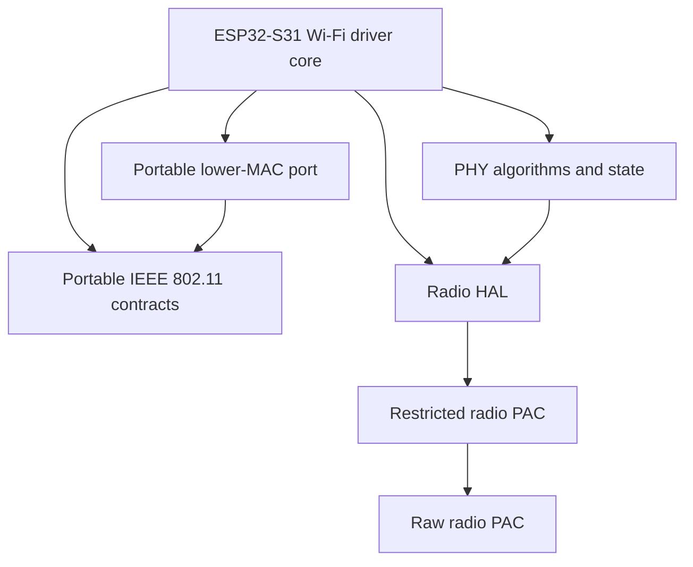
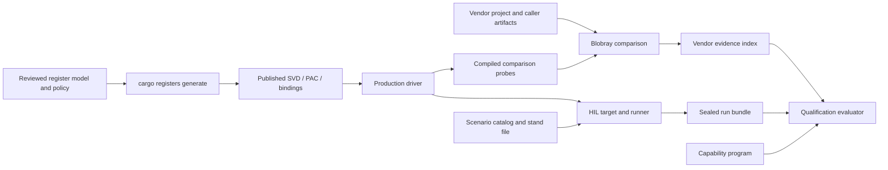

# Repository ownership

This document defines the boundaries between production code, hardware
descriptions, analysis tools, experiments and qualification. Detailed APIs and
commands belong to each component's README and Rust documentation.

## Owners

| Owner | Responsibility | Boundary |
| --- | --- | --- |
| [Radio libraries](../crates/README.md) | Portable protocols, typed hardware access, adapters, execution and final composition | Internal libraries depend on specific contracts; only applications depend on the public facade |
| [Registers](../registers/README.md) | Reviewed hardware model, API/ownership policy, provenance and publication inputs | Defines what may enter the production PAC |
| [Blobray](../tools/blobray/README.md) | Binary analysis, reviewed research and bounded comparisons | Generic engine; target facts are selected through providers and projects |
| [ELF view](../tools/elf/README.md) and [vendor provenance](../tools/vendor-provenance/README.md) | The one ELF/archive reader with the RV32 relocation table; the one vendor function fingerprint | Read by every tool; image placement is audited by the image pipeline |
| [Repository tooling](../tools/xtask/README.md) | Cargo graphs, source checks and build orchestration | Calls domain tools; does not duplicate their validators |
| [Verification](../verification/README.md) | Reusable chip knowledge and concrete vendor comparison projects | Private artifacts are caller inputs, never production dependencies |
| [HIL](../hil/README.md) | Typed protocol, lab fixtures, scenarios, target images and sealed observations | Produces hardware evidence; does not decide product readiness |
| [Qualification](../qualification/README.md) | Engineering map, capability declarations and independent assessment of a selected scope | Consumes evidence; does not run the hardware or vendor implementation |
| [Examples](../examples/esp32s31/thread/README.md) | Board/application composition and API usage | Own credentials, stack and sockets; do not depend on the HIL harness |

A directory identifies an owner. A Cargo workspace identifies a joint build
and lockfile boundary. They need not coincide, and a logical module does not
require a new crate. `validation` is an operation on a domain's inputs, not a
catch-all owner for unrelated tools.

### Package classification

Every Cargo package declares `package.metadata.open-radio.layer` and
`platform`. Layer describes responsibility and implies the scope: the
`contract`, `protocol`, `hardware`, `role`, `service`, `adapter`, `runtime`,
`composition` and `facade` layers are production, `experiment` is
experimental, and every other layer is development. The repository model
(`oer-repo`) is the one reader of the table: it types every key and rejects
unknown ones, and `oer-tidy` checks every package in seconds; platform is `portable`, `host`,
`chip` or `family`. Chip applicability requires a separate `chip` identifier, such as
`esp32s31`, and family applicability a separate `family` identifier, such as
`espressif`; no other classification carries either.
A `family` package holds code that is vendor-specific but not chip-specific:
a ported vendor driver, recovered coexistence tables, a register protocol
every chip of the vendor shares. `platform/<chip>/chip.toml` names each
chip's `family`. The architecture check builds a family package for the Rust
target of every chip of its family; the chips of that family may depend on
it, and it may depend only on portable packages and packages of its own
family. Portable and host packages never depend on a family
package, and a family package never depends on a chip package, so code shared
by a family cannot select one of its chips.
What chips have — Wi-Fi bands, Bluetooth modes, IEEE 802.15.4, core count —
is the `[properties]` table of `platform/<chip>/chip.toml`, read by host
tools through `oer-chip-profile`. Differences of address or register layout belong in the register model,
not in properties. A build dependency, which runs on the build machine,
must be a host or portable package. The identifier
starts with a lowercase ASCII letter and contains lowercase letters, digits or
hyphens. It identifies applicability, not the compiler target or an implemented
backend. These labels do not establish hardware qualification.
`supported-feature-profiles` enumerates alternatives to an all-features union.
Default builds are always checked as well. The facade also requires a minimum
build without default features. Lower compositions with mandatory choices use
their declared profiles; an empty feature set need not form a usable system.

### Layer dependencies

The repository model discovers every manifest and workspace member before
reading classification, and its dependency policy (`oer_repo::policy`, run
by `cargo tidy check`) is the one statement of these rules. Missing or
inconsistent classification is an error. Production path dependencies,
including optional and build dependencies, must resolve to classified
production packages. Test dependencies may compose an
experimental engine with production owners. Protocol/contract packages cannot
depend on hardware, adapters or execution. Internal packages cannot depend on
the public facade. These rules are independent of directory names and chip IDs.

| Source layer | Allowed production dependency layers |
| --- | --- |
| contract, protocol | contract, protocol |
| hardware | contract, protocol, hardware |
| role | contract, protocol, hardware, role |
| service | contract, protocol, service |
| adapter, runtime | contract, protocol, hardware, role, adapter, runtime, service |
| composition, facade | all production layers except facade |

### Host layers

Every development package that runs on the host (`platform = "host"`)
declares `package.metadata.open-radio.host-layer`; a portable development
package may. A host package depends, through any dependency kind, only on
packages of its own host layer and the layers below it
(`oer_repo::policy::host_edge_allowed`, run by `cargo tidy check`):

| Host layer | Holds | Examples |
| --- | --- | --- |
| `entry` | Command lines: argument parsing and calls | `oer-xtask`, `oer-tidy`, `oer-fw`, `oer-stand`, `oer-hil-cli`, `oer-hil-runner`, `oer-qualification`, `oer-register-tool`, `oer-verification-cli`, `blobray-cli` |
| `orchestration` | Experiments, run analysis, HIL image builds | `oer-hil-experiment`, `oer-hil-analysis`, `oer-hil-image` |
| `execution` | HIL execution: protocol, agent, DUT link, scenarios, workloads, families, run bundles, observer identity, the HIL lab | `oer-hil-link`, `oer-hil-workload`, `oer-hil-family-*`, `oer-hil-run-bundle` |
| `verification` | Vendor evidence and provenance, the register model, vendor scenarios and stands | `oer-vendor-evidence`, `oer-vendor-provenance`, `oer-register-model` |
| `stand` | The stand file, boards, the arbiter, owners, journal, hubs and power, stand hosts | `oer-stand-file`, `oer-stand-board`, `oer-stand-arbiter`, `oer-hil-flash` |
| `build` | Images and binary analysis | `oer-image`, `oer-riscv-*`, Blobray's libraries |
| `foundation` | Processes, files, host tools, chip profiles, the repository model, vendor pins, the devices layer and the data formats | `oer-process`, `oer-durable`, `oer-toolchain`, `oer-repo`, `oer-vendor-artifacts`, `oer-device-*`, `oer-devices`, `oer-image-bundle`, `oer-hil-run-bundle-format`, `oer-elf` (the ELF format, read by the image encoder too) |

So the stand and the build layer never reach HIL execution, verification
never reaches HIL execution or orchestration, and the foundation depends
on nothing above it. The shared relation library in
`hil/phy/esp32s31/relation/` belongs to the `verification` host layer, so
verification scenarios and probes may depend on it. Only entry crates
run a repository command line: `cargo tidy check` rejects a
non-entry package whose code spawns `cargo hil` or `cargo xtask`
(`oer_tidy::spawns`); a library calls the owning library instead.

### Host applications

The host side is independent applications. They share only libraries and
data formats, never each other's code; one application uses another by
running it as a process or by reading what it wrote.

| Application | Command | Owns | Uses |
| --- | --- | --- | --- |
| Dev kit | `cargo fw` ([`oer-fw`](../tools/fw/src/main.rs)) | Build an example's image, flash it or any bundle, monitor a board, list boards | Images, devices, chip profiles, foundation; nothing of the stand or HIL |
| Stand | `cargo stand` ([`oer-stand`](../stand/cli/src/main.rs)) | Stand file, boards and hubs, the arbiter's queue and leases, owners (free-form names), journal, host setup, fixture installation | Devices, the stand file format, foundation |
| HIL | `cargo hil` ([`oer-hil-cli`](../hil/host/cli/README.md)) | Runs, plans, run history, A/B experiments, HIL images | Stand libraries, images with HIL policy checks, devices, the run bundle format |
| Vendor verification | `cargo verification` (its own workspace, [verification](../verification/README.md)) | Vendor pins and fetch, provenance, typed scenarios, evidence shards, probes | Blobray's engine, binary analysis, vendor pins, the shard format |
| Blobray | `cargo blobray` (its own workspace, [Blobray](../tools/blobray/README.md)) | Binary analysis | Binary analysis libraries, foundation |
| Registers | `cargo registers` ([register tool](../tools/registers/README.md)) | Register model, review, SVD/PAC/bindings publication | Foundation, chip profiles, the bindings format |
| Qualification | `cargo qualification` ([evaluator](../qualification/README.md)) | Catalogs, programs, assessment | The run bundle, scenario catalog and shard formats, the repository model, foundation; never the runner, lab, HIL images or stand operation |
| Gate | `cargo xtask`, `cargo tidy` ([xtask](../tools/xtask/README.md), [tidy](../tools/tidy/README.md)) | Check registry, push, CI state, worktrees, sweeps, text policy | The repository model and foundation; every other application runs as a process |

Every host-layer package declares `host-app` and `host-boundary` in
`package.metadata.open-radio`. The application values are `gate`, `fw`,
`stand`, `hil`, `verification`, `blobray`, `registers` and `qualification`;
shared owners are `foundation`, `devices`, `images`, `analysis` and `formats`.
`application` marks private code, `library` an exposed library and `format`
a shared data contract. Command lines use `application`.

Normal and build dependencies cannot link another owner's `application`
code. Libraries cross only these boundaries; host layer rules still apply:

| Consumer | Permitted shared owners |
| --- | --- |
| gate | foundation |
| fw | foundation, devices, images, analysis, formats |
| stand | foundation, devices, formats |
| hil | foundation, devices, images, analysis, formats, stand, verification |
| verification | foundation, images, analysis, formats, blobray, registers |
| blobray, analysis | foundation, analysis, formats |
| registers | foundation, analysis, formats, verification |
| qualification, foundation, formats | foundation, formats |
| devices | foundation, formats |
| images | foundation, analysis, formats |

The `formats` owner exposes only `format` packages. Test dependencies may
compose applications for a regression; they still follow host layer rules.
The dependency policy is `oer_repo::policy::application_edge_allowed`.

`cargo tidy check` holds the dependency rules: the [host layers](#host-layers), these application boundaries,
qualification's ban on HIL orchestration and stand operation
(`oer_repo::policy::qualification_edge_allowed`), and one release profile for
every firmware workspace (`oer_tidy::workspaces::release_profiles`).

**Device foundation.** Every application that touches a board goes through
the devices layer ([`tools/device/`](../tools/device/README.md)): `oer-devices`
owns board operations as modules, with flash writes and the held-board facade
behind its `image` feature. Device identity, locking and the reference-peer
grammar retain independent packages with smaller dependency graphs. A board is
its [`DeviceId`](../tools/device/mac/src/lib.rs), the MAC its USB
Serial/JTAG port reports. The [device lock](../tools/device/lock/src/lib.rs)
lets one process own a board at a time for a whole operation (flash with
reopen and start, reset, monitor, a HIL lease with its power cycles); a
refused process names the holder, and the arbiter treats a board locked by
a foreign process as busy. The one flash write,
[`oer_devices::image`](../tools/device/devices/src/image/mod.rs), reads a bundle's
segments once into a verified snapshot, invalidates the board's known image
before writing, writes that snapshot and records a receipt (segment digests
and a write generation); "written" and "started" are distinct states, so an
unchanged image is not reflashed and an interrupted write leaves no stale
claim.

An independent lifetime broker owns the device lock's file description.
`DeviceAccess::operation` admits I/O atomically and returns a guard retaining
exclusion. Owner loss closes admission, then drains admitted operations; the
board becomes available only after their ports and readers close. External
hardware commands retain the same operation through a lifetime connection,
so caller death does not release exclusion before OpenOCD or uhubctl exits.
Delegates receive an admission capability, never the flock descriptor.

**Process context.** The process foundation supplies `Context` and `command`.
Applications select the fields of each intended child's context explicitly;
ordinary commands clear it. A single environment field transports the context
across exec, including an explicitly delegated Cargo or shell wrapper. The
next repository spawn clears it unless its caller attaches another context.
Device capabilities, stand leases and job identities use this path; host and
workload configuration remain ordinary environment settings. Process tests
exercise ordinary children, selected descendants, malformed contexts and owner
loss during real I/O, including an external writer surviving both callers.

**Image compile cache.** Every firmware build of a host, whatever the
checkout, application, chip, image class or example, and the vendor
comparison probes, compiles in one shared Cargo target directory below the
host build root (`oer_toolchain::image::compile_cache`,
`$XDG_CACHE_HOME/open-esp-radio/build/cargo`, overridden by
`OER_BUILD_ROOT`). Compiler flags are identical per chip, so units are
reused across builds; a build holds the cache lock from its Cargo run until
its outputs are copied out, and publishes its bundle by rename only after
full success.

### Sans-IO protocols, executors and time

Protocol logic is sans-IO. A `protocol` package is a set of state machines:
received frames, completed operations and the current time enter as values
(`oer_time::Instant`), and the actions to take and the next deadline leave as
values. It may declare the asynchronous ports its drivers implement, but it
never awaits; the architecture check rejects every `async` body and `.await`
in a protocol package's library sources. The drivers that wait on ports and
timers and feed the state machines are `service` packages, and a runtime or
an adapter polls them. The same state machine therefore runs under any
executor, in a synchronous interrupt context and against a host model with
virtual time.

Hardware owns chip resources and the wire codecs its registers carry. A role
composes portable role protocols (station, access point, security) with that
hardware, without an executor. A service declares executor-free ports; an
adapter binds them to an executor, so a service never depends on an adapter.
Only adapters, compositions and the facade may depend on an executor crate
(`embassy-executor`); every lower layer exposes futures that any executor can
poll. Only adapters, compositions and the facade may depend on the time
driver interface (`embassy-time`), whose single driver the final image links,
or on its `oer-time-embassy` binding; the rule covers dev dependencies too.
Every lower layer, runtimes included, reads and waits on time through the
[`oer-time`](../crates/time/src/lib.rs) `Clock` and `Timer` ports: a runtime
takes its timer from its owner or caller, a composition passes
`oer_time_embassy::EmbassyClock`, and runtime tests use the per-instance
virtual clocks of `oer-time-virtual`. Radio time follows the model below.
An adapter can implement a runtime interface, while a runtime can consume
an adapter's executor-neutral contract. Cargo still rejects actual dependency
cycles. Neither layer can depend on the final composition.

#### Clocks, stamps and alarms

Three kinds of time object exist, each in one domain:

- a **clock** reads "now" in its domain and nothing else: `oer_time::Clock`
  for monotonic time, a port's `now()` for its radio domain;
- a **stamp** is a value the hardware recorded when an event happened; it
  carries its domain and the generation of its clock relation
  (`oer_radio_port::RadioStamp<D>`, `RxMeta::timestamp`);
- an **alarm** wakes something at an instant of its domain. An executor
  **wait** is an alarm of monotonic time (`oer_time::Timer`); a hardware
  timer of a MAC or PHY (the station TBTT, the TSF timers, the BLE modem
  LP timer) is an alarm of its own domain, armed through a port operation,
  never an `oer_time::Timer`.

The domains in the code:

| Domain | Counted by | Type | Relation (`ClockRelation`) | New generation |
| --- | --- | --- | --- | --- |
| Monotonic CPU time | the system timer through `oer-time-embassy` | `oer_time::Instant` | itself | — |
| ESP32-S31 Wi-Fi MAC local time | `WIFI_MAC_LOCAL_TIME` (`MacLocalTime`), widened by `MacTimeline` | `Ieee80211Instant`, `Ieee80211Stamp` | affine to monotonic time; no relation owner exists until an S31 backend implements the lower-MAC port | `Ieee80211ClockGeneration`, from that relation owner's `GenerationSource` |
| IEEE 802.11 lower-MAC host model | the test (`set_now`) | `Ieee80211Instant` | identical to monotonic time | — |
| An interface's TSF | the MAC's TSF of that interface | `TsfInstant` of `Ieee80211Tsf`, as `VifTsf` with its interface | affine to the port's radio clock (`TSF_RELATION`, `TSF_DRIFT_PPM` = 200 ppm: the access point's timer and the station's crystal), sampled by `TsfSample` | a `TsfGeneration` (`Generation<TsfInstant, Ieee80211Instant>`): the epoch each relation's owner is created with (`LowerMacConfig::tsf_epoch` for the S31 core), so owners never share one, and the jumps within it: a channel change, an interface (re)configuration, an access-point TSF restart, a station TSF set beyond the relation's bound, a TSF crossing 2^64 (the TSF is never modular). A sample of another generation does not convert (`TsfProjectionError::StaleSample`) |
| BLE controller | the controller clock, extended from its 32-bit latch | `LeInstant`; inside the driver `SchedulerInstant` | none to monotonic time | — |
| BLE modem LP timer | the modem LP timer | `BluetoothModemLpTimerInstant` (wrapping, no claimed unit) | none | — |
| IEEE 802.15.4 | the runtime's monotonic clock | `Ieee802154Instant` | identical to monotonic time | — |
| FTM | the FTM exchange's timestamps | `FtmTimestampPs`, 48-bit picosecond wire values (`oer_ieee80211_mac::ftm`) | none | — |

Rules:

- A sans-IO protocol takes time as values of its own domain. A deadline it
  returns for the executor to wait on is a monotonic `Instant`; an instant
  it returns for a hardware alarm stays in that alarm's domain, and the
  driver arms it.
- Domains do not mix at the type level: a port's instants are
  `RadioInstant<D>` of its own domain `D`. A radio instant is a coordinate
  in its owner's radio epoch, not an image-monotonic or wall-clock instant.
  Its raw microseconds establish no relationship between clocks. The owner
  retains any additional interface, instance and generation validation.
- Radio arithmetic belongs to `oer-time`: `RadioDuration<D>` represents
  every non-negative `u64` microsecond span of the domain `D`, as
  `RadioInstant<D>` does its instants. A span adds only to an instant of its
  own domain and combines only with spans of it, and a window's span is of
  its start's domain; other mixes do not compile. Instant ordering and
  `checked_duration_since` require the same domain; equal instants yield a
  zero span and reversed instants fail. Instant `checked_add`/`checked_sub`
  and duration `checked_add`/`checked_sub`/`checked_mul` return `None` for
  results outside the represented range, without wrapping, narrowing or
  clamping; duration `checked_rem` returns `None` only for an empty period.
  `RadioWindow` is non-empty and half-open, with a representable
  exclusive endpoint; touching windows do not overlap. Scalar extraction
  belongs at named formula or representation boundaries. Monotonic
  duration is not a substitute for radio-domain arithmetic.
- Time crosses between domains only through one relation type
  (`oer-radio-port`): a `ClockRelation<A, B>` of a source domain `A` and a
  target `B` (identical, or affine within a drift bound), a
  `RelationSample<A, B>` of back-to-back readings with its uncertainty and
  generation, and one projection both ways (`project`, `project_back`,
  `project_span`) whose uncertainty is a span of the target domain
  (`Projected<T, S>`). A port publishes its radio clock's relation to
  monotonic time in `ClockInfo<D>::monotonic`, or `None` when none exists;
  the TSF relation is `TSF_RELATION`, sampled by `TsfSample`. The types name
  their pair of domains, so a relation, sample or generation of one pair
  does not serve another. A coordinate of another generation than the
  sample is not converted (`ProjectionError::StaleSample`).
- A generation (`Generation<A, B>`) has no public constructor: only its
  relation owner's `GenerationSource` makes one, opening an epoch the owner
  takes and jumping at each break of the relation.
- Time-exact work stays in its domain: the station follows the access
  point's TSF by the MAC local time between a beacon's stamp and now, not
  through monotonic time. A software handoff bound is monotonic: the HE
  Trigger and NDPA response windows count from the frame's executor handoff
  (`RxTimes::handoff`).
- The hot path only records values: a received frame carries
  `RxTimes { handoff, stamp }` with the raw stamp, and no clock is read on
  reception; a consumer that needs the reception time converts the stamp.
- Hardware counters and alarms belong to their driver and reach the layers
  above as read-only capabilities (`MacLocalTime`) or port operations.

## Ownership and refusals

Every module follows these rules when it designs an API, and every agent
checks a design against them before it writes the code. Owner decisions:
[single ownership](https://github.com/ermacv/open-esp-radio-rs/issues/581#issuecomment-6113824978)
and [#599](https://github.com/ermacv/open-esp-radio-rs/issues/599). The
owner's words: every check that can be a compile-time check must be one;
the code adapts to clean modules with hard, defined contracts, never the
other way round.

**Single ownership.** A resource has one owner, a value that is neither
`Clone` nor `Copy`. Exclusivity follows how long it lasts:

- within one call it is `&mut` on the owner;
- beyond the call (a transmit queue while its attempt is on the air) it is
  a token or lease the holder gives back;
- an occupancy that ends by itself is awaited, not refused.

Across executor tasks, which need `'static` futures and cannot share a
borrow, the owner is an actor: one task holds it, and the others send it
requests and await its replies. A handle shared between tasks over an
internal mutex is not ownership.

**An interrupt entry shares no lock with a task.** A backend's core has one
owner, and its interrupt entries reach that owner in one of two ways
([owner's verdict on #643](https://github.com/ermacv/open-esp-radio-rs/issues/643#issuecomment-6118913726)):

- **The interrupt latches, a task owns.** Where no decision has a
  deadline below the event path's latency, the interrupt only reads and
  clears its own status registers and posts the event. The core's owner
  task handles it with `&mut`. This is the Wi-Fi model (the MAC and power
  interrupts, #563) and the Bluetooth LE model, whose hardware scheduler
  keeps the air timing.
- **The interrupt's context owns.** Where a decision must be made in
  interrupt context, the core lives where only that interrupt's level on
  its core reaches it. Tasks post commands to a lock-free queue and ring a
  doorbell software interrupt at the same level and core, so the doorbell
  and the hardware handler never preempt each other. A command has no
  synchronous reply: its result is its terminal event, and a caller's
  refusals are types before it is posted. This is the IEEE 802.15.4 model
  (#668), whose ACK, enhanced-ACK and SFD frame-patch decisions fall
  inside the 192 µs turnaround.

Neither model reaches a caller as a refusal or a blocking lock. A
measurement a backend publishes (a recent RSSI, the radio
clock) has one writer and is read as an atomic snapshot without a lock.

**Who controls a state decides its form.** List every refusal and error
an API would return and ask who controls the state behind it.

| Controlled by | Form | Examples |
| --- | --- | --- |
| The caller's own commands | a typestate: the value's type is its state, and a transition takes it by value | an owner `Disabled`/`Enabled`; a transmit gate closed |
| The caller's own earlier submission or resource | a token: minted by the owner of the resource, neither `Clone` nor `Copy`, given back to end it | admitted work, a queue lease, an installed key, a Block Ack agreement, a Bluetooth LE set |
| The caller's own capacity | a pool of tokens handed out once; "full" is an empty pool the caller holds, not a refusal | key slots, accept-list entries |
| The caller's own values | a validated type branded by the backend's type (`SupportedChannel<B>`), which only that backend's capabilities construct and the call takes instead of the raw value; a lifetime brand only for a capability that varies at run time | a supported channel, rate or transmit power |
| The world (the air, time, the hardware, a peer, the arbiter) | a typed outcome or refusal | a poisoned backend, lost events, a clock that could not be read, a coexistence rejection, a cancel that finds the work already ended |

A refusal such as `Busy`, `Disabled`, `AlreadyInState`, `Unknown…`,
`No…Slot` or `Unsupported…` that a caller's own state explains is a design
defect: it is replaced by the form in the table.

**What makes a guarantee hold.** A guarantee is written down only with
what enforces it:

- a type rule has a compile-fail test that breaks it, pinned to its error
  code, and a compiling twin that differs only in the broken rule, so the
  test fails for the stated reason;
- the language cannot forbid `Clone`, `Copy` or `Default` on another
  crate's type, or make a value linear, so the owner of a type proves it of
  its own types with compile-fail tests: its owners, loans and tokens have
  no value outside it (no `Default`, `Clone`, `Copy` or public
  constructor), and everything that can act on a resource borrows the loan
  it came from;
- a guarantee that is neither is not claimed.

Regulatory legality is policy, not capability: a channel the region allows
is its own validated type
([#323](https://github.com/ermacv/open-esp-radio-rs/issues/323)).

**The install brand.** Every port-lifetime value of one install carries
its brand `'id`: the owner, its `Ended`, the resources the body receives
once, and every token a backend mints for them. The body is generic over
`'id`, so it names no concrete brand and cannot prove one `'static`: no
branded value leaves the body, and none reaches another install. The brand
is invariant and costs nothing at run time. Wi-Fi's sans-IO machines are
parameterized by branded token types and own them directly; BLE and
IEEE 802.15.4 retain their existing core and boundary arrangements.

**Capacity as tokens.** An install's capacity is tokens a stateless
`Mint<'id, P>::into_pools(self)` issues once for the backend's `resources`.
The backend declares its complete layout as `type Pools: PoolSet`; a custom
layout consumes one `PoolBuilder<'id, Path>` to expand its components. Each
tuple member receives a sealed `Child<Path, INDEX>`; tokens retain that path
through custom nested layouts, even when kinds repeat. `Slots<K, N>`
and `Permits<K, N, S>` describe: slots (`Slot<'id, K, Path>`,
of semantic kind `Kind` and a unique component path), which a caller takes
synchronously from the ones it holds, an installed resource holding its slot
until its removal gives it back; and permits (`Permit<'id, K, Path>`), which a
`PermitPool` hands out to awaiting takers and takes back when the work that
held one ends with its terminal event, not when a handle drops. A taker
waits for a permit with a seat (`Seat<'id, K, Waiters>`), its place in the pool's
line, which it keeps across takes: `Permits` issues the waiter's path with
the `Line` that sizes the pool's line. The initial `PermitSupply` is opaque
and indivisible: a FIFO consumes it whole, so one minted pool cannot be
split into two interchangeable FIFOs. Several distinct permit supplies may
share a waiter line explicitly. Each line retains its path and capacity,
so a taker without a place cannot exist and a pool never overflows. A pool's
free list, its waiters and its order belong to a runtime crate or the
backend; its order is its documented policy, first in, first out by default,
which the conformance suite checks. A pool whose permits admitted work holds
belongs to the backend's held part of the install (`PortBackend::Held<'id>`),
which `run_port` keeps and the owner lends into each phase and disable: the backend
takes the permits back when the work ends and before it hands the terminal
event out, so no caller holds a permit of submitted work, and a terminal
event dropped unread loses none. Wi-Fi instead transfers its owned ticket,
MPDU and opaque `Context: 'id` into each admitted attempt and returns them
in its single or aggregate terminal. Its data context also carries the
access-category admission token; a terminal routes those resources by
context, without a parallel boundary identity table. BLE and IEEE 802.15.4
keep their existing permit ownership. A caller that holds no capacity token
turns that into its protocol's decision.

**Port-lifetime and phase-scoped tokens.** A resource that outlives a phase
(an installed key, a Block Ack agreement, a configured interface, a
Bluetooth LE set) has its token owned by the port's owner, set up while it
is disabled and lent into each phase, so a phase that ends (a channel move)
neither loses nor re-installs it. Admitted work and the leases it holds (a
transmit queue, an operation slot) are phase-scoped: they borrow the phase
and end with it. Each protocol's refusal-to-type table says which its
tokens are.

**Sans-IO cores.** Wi-Fi's core is generic over branded tokens: Station,
Data and Arbiter hold their resources by value and return owned actions.
A queued TX context preserves the install brand without borrowing a local
machine. `LinkView` and other short synchronous borrows remain local to a
step. The backend transports the context without interpreting it, and a
terminal returns the original context and exactly its operation's resources.
The Wi-Fi service therefore needs no completion identity table.

BLE and IEEE 802.15.4 retain their existing arrangement. In particular,
a `'static` BLE core keeps its own `EventId`; its phase boundary table maps
that ID to the phase token and carries out the core's decision. Wi-Fi's
branded core does not require a change to either other block.

**Proofs say exactly what they prove.** A guard proves its own state and no
more: a closed transmit gate proves that this port publishes no
transmission (`TxGated`), not that the air is quiet; reception runs, and
other radios and peers still transmit.

**A resource's lifetime is a body.** An owner of hardware lives inside one
body that must return a proof of its end (`Ended`), which only its
uninstall or a fail-stop constructs; a body that drops or forgets the owner
does not compile. The body runs as an executor task, which is not
cancelled, and its parts run inside it under `join` over disjoint borrows.
Its transitions take the owner by value and are bounded by contract: each
ends within its bound or as poisoned, and an unbounded wait (an arbiter's
lease) is a separate cancel-safe step before it. A transition that ends
work hands every leftover terminal to a sink it takes and completes only
when every permit is back. IEEE 802.15.4 submission moves its capacity
permit into the backend; the held pool takes it back before terminal delivery. BLE reserves outcome
capacity before admission. Wi-Fi returns its ticket and admission token in the
terminal instead. Both forms reserve terminal capacity; only unsolicited
reception may lose events. BLE and IEEE 802.15.4 retain the body joined with
the backend's driver, its runner, in one task
([#581 decision](https://github.com/ermacv/open-esp-radio-rs/issues/581#issuecomment-6120815544),
a working shape until Wi-Fi's #271 A/B): the driver progresses whatever the
body awaits, owns the backend's state by value or reaches it in the held
part directly, and is cancel-safe. One owner reaches that state at a time,
the body's task or the backend's interrupt context; anything beside the
body reaches it only through atomics or signals, and in the
interrupt-owned form terminals and receptions never depend on the driver.
Shared per-install state is reached by a synchronous closure (`with`) that
calls no port method; an interrupt-owned backend's body runs on its
routes' core, which the route binding's type states; IEEE 802.15.4's
interim critical section is the one exception, until #668
([decisions](https://github.com/ermacv/open-esp-radio-rs/issues/581#issuecomment-6121016144)).
Wi-Fi's S31 driver is assigned its own executor and exclusively owns the
hardware core and TX execution; the body transports owned commands and
terminals, following [#563](https://github.com/ermacv/open-esp-radio-rs/issues/563#issuecomment-6150013206).
A retune stays a bounded step of `enable`. The owner's uninstall only asks:
`run_port` retires the driver within the backend's bound (a missed bound is
a fail-stop), detaches the interrupt entries synchronously, then takes the
backend apart with the held part and the driver's state by value, returning
the hardware owners by value. In the shared BLE/IEEE 802.15.4 core, a
dropped owner latches abandonment and wakes the core and driver. The core
cancels the body, synchronously poisons the installation, then retires the
driver within its bound. `abandon` returns either `Stopped`, with proof of
masked IRQ entries, bounded CPU exclusion and hardware stopping, or
`Unconfirmed`, requiring permanent quarantine until chip reset. No path may
wait without a bound on an ISR lock. The current BLE and IEEE 802.15.4
backends return `Unconfirmed`; they do not prove hardware stopping.
Explicit `fail_stop` invokes `abandon` immediately and returns an affine proof. Retirement progresses while the
body waits; final detach follows the body's return. Cancellation of the
whole `run_port` future repeats synchronous quarantine. No owner transition
or abandonment requires a panic.
Everything the hardware touches is `'static` and owned by the resource, so
forgetting a future cannot release hardware-reachable storage. Composition
crates disallow `core::future::pending` in their own `clippy.toml`, so a
body does not end by pending forever.

**Compile-time values.** Capabilities that are the same for every instance
of a backend type are associated constants, and a literal value is checked
with `const { assert!(..) }`; a value from outside (configuration, a scan)
is parsed once at the boundary into its validated type; a capability of
one instance carries that install's generative lifetime, which stays inside
its body; counts and capacities are const generics.

A borrow binds a loan to its lender: a loan type is invariant in the
lender's borrow, and the lender's signature, not the borrower's types,
fixes it.

A radio port applies these rules through its owner, its phases and its
tokens ([Radio ports](#radio-ports)).

## Changing a shared contract

A shared contract is a crate or trait that more than one block depends on.
Each block guide skill lists its own under "Shared contracts"; today they
include `oer-radio-port`, the permit pool, `oer-time`, the shared radio
system, PHY, coexistence, the HAL split, the PAC and `registers/`. It takes only what at least two blocks have proven in code; a
need of one block stays in that block until a second one has it. A change
starts from a prototype in the block that needs it, showing the case the
current contract fails, and lands before the blocks that depend on it build
on it.

Every proposed change comes with a cost table, and is not accepted without one:

| Column | What it states |
| --- | --- |
| Checks | where each check runs: at compile time, or what stays at run time (a panic, a refusal, a wait) |
| Code size | the new monomorphized copies, and which generic code they come from |
| RAM and CPU | the memory, and the time on each hot path it touches |
| Signatures | the lifetimes, parameters and items it adds to the contract |
| Breakage | what it breaks, and which blocks must rebase or rework |
| Alternatives | the options considered, and why each was rejected |
| Reversal | the measurement that would undo the decision |

Bounds, cancellation and the slot of each terminal are specified before
the contract's shape. Generic code over a marker type is a thin wrapper over
one non-generic core, so a marker that multiplies (one per role, access
category or interface) does not multiply the code; such an identity lives
in a value the owner mints rather than in a type parameter.

## Package names

Every package is named `oer-` followed by lowercase tokens in this order: an
optional chip (`esp32s31`) or family (`espressif`), the domain (`ieee80211`, `bluetooth`, `ieee802154`,
`coex`, `radio`, `memory`, `network`, `hil`, `example`, …), an optional
component (`mac`, `sta`, `rsn`, `runtime`, `system`, …) and, for adapters, the
binding (`embassy`, `esp-hal`, `embassy-net-owned`). The
directory repeats the same tokens under its layer directory; grouping
directories such as `driver/`, `security/`, `le/` or the binding directory of
an adapter add structure without renaming. Wi-Fi is `ieee80211` in package and
directory names alike; the facade feature `wifi` and `Wifi*` types keep the
user-facing name. Compositions end in `-system`. The public facade
`open-esp-radio` (library `oer`) is the only branded name.
`oer-tidy` (`cargo tidy check`) enforces the prefix. The Blobray
workspace names its own packages.

## Radio ports

A radio port is the contract between the protocol logic of one radio
protocol and the backend that executes it: a chip, a family driver or a host
model. Everything above a port is written once for every backend; everything
below it is the backend's. Every port runs on the owner shape, whose
lifecycle all three radio blocks share in `oer-radio-port`:
`run_port` consumes an `Installed` backend and its independent driver, and
lends the body an `Owner` whose transitions and phase make caller rules
expressible as types. The Wi-Fi model and portable consumers use this same lifecycle.
A driver has no installation brand; branded queues and in-flight owners
live in `Held<'id>`. A driver returns retirement or published poisoning with
an affine proof. The core retains its state while a faulted body drains
earlier events and returns its uninstall request. `PortBody::Output` is
chosen outside the fresh installation brand; branded owners cannot escape
through it. `PortEnd` returns uninstalled owners and output, fail-stopped
output, or abandonment without a body result.
[`LeRadioBackend`](../crates/protocols/bluetooth/le/radio/src/port.rs)
is the Bluetooth LE backend, over `oer-radio-port`; the
[owner shape](../crates/protocols/ieee802154/src/owner.rs) of the
IEEE 802.15.4 port, over `oer-radio-port`, is what the Espressif
runtime's backend implements and the OpenThread adapter consumes; and the
[lower-MAC port](../crates/protocols/ieee80211/lower-mac/README.md) is the
Wi-Fi one, over `oer-radio-port`, carrying the portable `Channel` and
`PhyRate` values of `oer-ieee80211-mac`. The vocabulary they share (the
brand and capacity tokens, the refusals, the poisoned outer error, the loss
marker and the clock relation) is the contract package
[`oer-radio-port`](../crates/radio/port/README.md)'s.

**Placement follows hardware autonomy.** Work the backend performs without
software on the air timeline (acknowledgement turnaround, FCS or CRC,
hardware retransmission, hardware ciphers) lies below the port. Work that
software decides (retry policy, rate selection, contention draws, reordering,
sequence and packet numbers, scanning, beacons, power-save policy) lies above
it, in portable code shared by every backend. A backend that also performs
work above the port reports that in its capabilities, and the portable owner
delegates it instead of performing it. For IEEE 802.11, one port
publication is one hardware transmission attempt, and the caller chooses the
retry plan above the port. Two items of the list are an exception there: the
backend draws its queue's contention and numbers protected MPDUs (CCMP packet
numbers) below the port, without reporting either in its capabilities;
sequence numbers stay above the port.

**Shape.** A port is a trait defined in a `contract` or `protocol` package,
without an executor or a time driver. It has the same five parts for every
protocol:

| Part | Semantics |
| --- | --- |
| Submission | Immediate admission of one request with a caller-chosen correlation identity: refusal is the call's result, never a later event, and a value, not a fault. Submission is synchronous when a backend can decide without waiting; a port whose backends need a fresh hardware reading to decide may declare it asynchronous, provided the wait is bounded and depends on no other submission or event. Dropping the future of a backend that admits in the caller's future admits nothing; a backend whose driver admits (Bluetooth LE) withdraws a request its driver has not taken, and serves one it took to the end, its effects standing and its reply discarded |
| Events | Asynchronous stream of owned events, each viewed through a borrowed portable value, with exactly one consumer; loss of events is reported, never silent |
| Capabilities | What the backend supports and what it performs autonomously, read before submission |
| Lifecycle | Enable, disable, quiesce and cancel of submitted work, each with a terminal event; `Disable` ends the work in flight first |
| Clock | The backend's radio time on the shared time contract, with a stated resolution and the relation of its epoch to monotonic time (`ClockInfo`); asynchronous under the same conditions as submission |

**Authority.** An installed port lives in one body (`oer_radio_port::PortBody`,
run by `run_port`) that must return `Ended`, which only the owner's
uninstall or a fail-stop constructs. The body's `Owner` has the port's state
as its type (`'p` is its borrow of the install `run_port` keeps, `'id` the
install's brand). An `Owner<'p, 'id, B, Disabled>` lends the protocol's disabled-only
settings (a permanent channel move, interface configuration, and the
port-lifetime resources such as keys and agreements, whose tokens it keeps
and lends into each phase) and is the only state that asks for the
uninstall, which `run_port` carries out after it retired the backend's
driver; its
`enable(self)` returns an `Owner<'p, 'id, B, Enabled>`, the disabled owner with the
radio's refusal, or a `PoisonedOwner`. An `Owner<'p, 'id, B, Enabled>` lends one
running phase at a time (`split`): the phase's one event consumer, its
control (the radio-wide operations that only gate or tune admission, as
guards with one holder, never refusing as busy; a closed transmit gate is a
`TxGated` proof) and its interface-scoped clients, each a `Lent` of the
owner's borrow; its `disable(self, sink)` hands the leftover terminals of
the phase's work, with their bodies, to the sink and returns the disabled
owner once every permit is back. A client's submission returns its admitted
work as a token the backend mints, holding the client that admitted it;
the work ends only through that client (`work.cancel()`). No call refuses for a state the caller controls
([Ownership and refusals](#ownership-and-refusals)). The Bluetooth LE
backend (`LeRadioBackend`), the IEEE 802.11 lower-MAC port
(`LowerMacBackend`) and the IEEE 802.15.4 owner shape are built on `Owner`
and `PortBody`.

**Correlation identities.** Each port keeps its own 32-bit identity type
(`TxId`, `RequestId`, `EventId`), so a completion of one port cannot be
taken for another's work; each implements `oer_radio_port::Correlation`,
the top 256 raw values are reserved for work the backend submits itself,
and a caller's `CorrelationIds` allocator wraps before them.

**Event model.** Every port has exactly one consumer of its events. Users
that share a port share it through a router that owns the stream and
dispatches each event by its identity. Taking an
event only dequeues it. Timed work a backend performs in software (the
802.15.4 CSMA-CA backoffs and retry delays, the Wi-Fi publication watchdog,
the Bluetooth LE scheduler) runs in its backend's driver
(`PortBackend::drive`),
which `run_port` joins with the port's body; the driver owns the radio and
its hardware by value and serves the port's requests as messages.

**A port exists only while its backend is installed.** A backend's
`install` returns two handles that borrow its runtime, and no other value
reaches the installed backend: the port, for the protocol's one event
consumer, and the control, for the composition, which carries the backend's
own operations (coexistence, statistics and diagnostic hardware reads).
The control's `uninstall` consumes both, so "not installed" is
unrepresentable and no port call refuses as such. The interrupt entries and
the runner stay on the runtime itself. Shared-PHY maintenance is not a layer
over `Quiesce` and never pauses a port: PHY tracking and recalibration run
under the radio arbiter's lease with the vendor grant-protect brackets, the
protocol keeps running, and an operation that loses RF to them ends with its
ordinary terminal event. A port's
event stream lives as long as the port: `uninstall` discards the events it
did not deliver, the terminal events still owed and a pending loss, and the
next install's port starts with an empty stream; every event guarantee
below holds for the port's lifetime. The Bluetooth LE backend differs: its
`install` returns one backend, which `run_port` runs under the port's
owner, and its owner's `disable` stops the scheduler and hands every
admitted event's end, with what the hardware recorded, to the body, so
none is discarded; `run_port` then retires the driver and the uninstall
returns the radio and its hardware.

**Loss and poisoning.** A backend reserves the slot of every event whose
loss would break a guarantee when it admits the work: every terminal event
(an attempt's completion, an operation's or an event's end, a lifecycle
terminal) and data its protocol promises the peer to deliver once the
hardware acknowledged it (the data PDUs of a Bluetooth LE connection event,
whose Link Layer delivers reliably). Such an event is never lost, and work
that does not find its slots is refused. A backend that drops data the
protocol does not promise to deliver (Wi-Fi and IEEE 802.15.4 received
frames, Bluetooth LE advertising reports) reports one `EventsLost` in place
of the first dropped event: events before it precede the gap, events
after it follow it, and the consumer continues. A poisoned backend's state
is unknown: `next_event` returns `Poisoned` with the backend's cause after
every earlier event and again at every later call, and every other call
returns it at once; only a reset restores the port.

**Capability model.** A port states what a backend can do in three separate
places. A structural optional feature (an operation some backends lack
entirely, such as aggregate transmission or TBTT reporting) is an extension
trait over the base port: an upper layer that needs it requires that trait
bound, and a backend without it does not implement the trait, so the missing
feature cannot be requested. The parametric limits of what a backend has
(bands, rates, queues, key slots, window sizes, the accepted range of a
value) are its capabilities, read before submission; a value outside them is
refused as unsupported, and that refusal means nothing else. Why a backend
lacks a feature or a value (hardware absent, glue not written, vendor
knowledge not recovered, policy decision pending) is recorded in the
qualification catalog, not in code.

**Refusals and poisoning.** Every port call returns
`Result<Result<T, Refusal>, Poisoned<Fault>>`. The inner `Err` is a typed
refusal: nothing changed, and a refused submission hands its arguments back
(a Wi-Fi attempt with its buffer and body). A port exists only while its
backend is installed, so no call refuses as not installed. Admitted work that ends
without its result reports that in its terminal event (an aborted attempt,
a `Fault` that leaves an IEEE 802.15.4 radio disabled, a lifecycle
`Failed`), and the port stays usable. The outer `Err` is only
`oer_radio_port::Poisoned`, which carries the backend's own cause (each
port names it as `type Fault`); portable code passes it on without
interpreting it.

| Port | Lifecycle and cancellation | Clock relation to monotonic time (ESP32-S31) |
| --- | --- | --- |
| IEEE 802.11 lower-MAC owner shape | the owner's `enable` (with the retune a channel change needs) / `disable(sink)` transitions; an admitted attempt has no cancellation and ends only in its terminal, which returns its ticket and buffers | affine: the Wi-Fi MAC local time, sampled against the image's monotonic clock; no ESP32-S31 backend implements the port yet |
| IEEE 802.15.4 owner shape | the owner's `enable` / `disable(sink)` transitions and the interface client's `Work::cancel`; the one operation permit returns with its terminal | identical: the runtime's `Clock`, which the engine reads fresh at each event and the time driver also reads |
| `LeRadioBackend` | the owner's bounded `enable` / `disable(sink)` transitions and the phase client's `cancel(EventId)`; install and uninstall move memory and hardware owners and stay the backend's own operations | none: the extended controller clock |

**Shared RF path.** Protocols that share one radio name themselves with the
portable [`RadioClient`](../crates/radio/coex/src/lib.rs) of `oer-radio-coex`
and express how urgently an operation needs the antenna as its
`CoexPriority`; each protocol's own levels convert into it. The backend maps
both onto its arbitration (event numbers, request kinds, hardware
priorities), which stays below the port.

**Names.** `*Port` is a portable contract trait. `*Service` is a portable
state machine that consumes ports. `*Hardware` is a chip or family register
seam below a port. Bluetooth is `bluetooth`/`Bluetooth` in every package,
module and type name.

## From policy to an application

The production path is deliberately directional:

| Boundary | Decides | Retains |
| --- | --- | --- |
| Portable protocol/service | Valid frames, role transitions, request planning and typed outcomes | Protocol values and affine logical state; never PAC ownership |
| Chip HAL/driver | Semantic register transactions, DMA/IRQ state and physical transition results | PAC capabilities, stable-memory proofs and fail-stop hardware frontiers |
| Chip role | Ordering of one role's association, security and data plane over the chip driver | Executor-free role owners and their returned hardware frontiers |
| Concrete runtime | Which owner-bearing future is polled and how wakes, deadlines and bounded mailboxes progress | Active role/session owners across awaits and client cancellation |
| Composition | One-time storage placement, board/chip roots, final IRQ bindings and application capability split | The sole hardware runner plus static resource claims |
| Application/facade | Credentials, requested role, network/IP policy and sockets | Hardware-free control handles and application packet/socket owners |

The command plane moves requests and value reports between the application and
the sole actor. Submission is not hardware publication, and a response is not
necessarily frame completion. The data plane separately moves bounded packet
leases through adapter queues, stable storage, DMA publication, terminal
completion and return. A protocol policy may request an operation without
owning the PAC; conversely, the concrete actor owns the hardware epoch without
becoming the authority for protocol semantics.

Applications start from the public facade or the final chip composition. The
shared radio composition (`oer::systems::esp32s31::embassy::radio`) starts the
radio once with its periodic tasks, and each protocol composition joins it
with its partition. Developers of a lower subsystem start from its defining
crate and owner types.
This is why internal crates depend on specific lower contracts and never route
their dependencies back through `oer`.

Here each arrow points from a consumer to a production dependency; the diagram
selects the Wi-Fi driver layers and omits other dependencies and feature
profiles. This differs from the knowledge-flow diagrams: Blobray, register
publication and qualification do not enter the production dependency graph.
Calls can pass through a portable port implemented by a higher composition
without introducing a reverse Cargo dependency.

Portable packages cannot depend on chip, family or host packages; the public
facade is the explicit selection boundary. Chip packages can depend on portable
packages, packages of their own family and packages for the same chip. Host packages can depend on portable
or host packages. Cross-chip dependencies are rejected. S31-specific firmware,
diagnostic and register-authority checks remain separate from these general
rules; adding a chip does not make those hardware checks applicable to it.

`open-esp-radio` provides the `oer` library. Its public modules reexport existing
types; `oer-radio-port` owns the radio port lifecycle. The facade may depend on
a selected composition, never the reverse. PAC access remains an explicit restricted dependency.

`composition/` names the source ownership layer; `oer::systems` is its public
namespace. Facade features select portable protocols, concrete chip backends
and final Embassy compositions independently. Exporting a composition does not
claim hardware qualification; component capability limits still apply.

Internal radio packages use the `oer-` prefix and identify their domain and,
where required, chip: `oer-memory`, `oer-ieee80211-sta`, `oer-esp32s31-hal`.
Rust imports use those dependency names; internal crates do not route imports
through `oer`. Module paths carry context so types can use names such as
`sta::association::{PhyMode, Preference}`. State names retain ownership and
publication distinctions.

A type has one defining owner. For example, association modes are defined in
the lower IEEE 802.11 wire-codec crate and reexported by the station policy
module and facade. The encoder never depends on the station policy or facade.

## Data and decisions

The evaluator reads serialized evidence independently of the producers.
Its engineering map connects knowledge, source owners, checks, observations and
next-work reasons. Static catalog views require no saved runs; program views
retain the evaluator's evidence-applicability decisions. Neither view runs
missing checks or turns the whole project into one readiness gate. Knowledge
and source facts remain useful outside a selected qualification program.
Implementation, host coverage and async states are reviewed declarations;
vendor/HIL states are derived from evidence. A valid incomplete capability
program is not a passing readiness gate. The exact rules are defined in the
[verification and qualification contract](verification-and-qualification.md).

## Hardware descriptions and providers

`registers/<chip>/model` owns devices, peripherals, MMIO maps and reviewed
assertions. `policy` owns API selection, lints and shared register ownership.
`evidence` carries the provenance used by publication. `upstream` is reviewed
input; `published` contains generated SVD/bindings. Generated Rust stays with
the production PAC that consumes it.

A peripheral whose layout is identical on several chips has one layout in a
register library such as `registers/ieee80211`, placed by each chip's
`device.toml` at its own base address with that chip's reviews. The library
publishes the register blocks and their reviewed transactions, without any
address, into portable hardware crates (`oer-ieee80211-pac-raw` and
`oer-ieee80211-pac`); each chip's raw PAC re-exports the blocks under its
addressed `Periph` type. Shared code takes the register block by reference and
is monomorphized per chip, so no chip is selected by `cfg` in portable code and
nothing is dispatched at run time. Only closed chip PACs and HALs may depend on
these crates, and a Bluetooth graph may carry them because they are register
access, not Wi-Fi software. A layout that differs between chips forks into a
per-chip fragment.

Source-only publication selects the model, API, assertions, provider, lint
pack and evidence catalogs explicitly. It does not select private vendor
binaries. Full vendor investigations add their own artifact context. These
compositions have separate validation requirements.

`verification/<chip>/` holds each chip's typed comparison scenarios,
compiled probes and native evidence index. Generic Blobray crates do not depend
on a chip project; the scenarios depend on Blobray.

## Statics in zeroed regions

A board's runtime linker script places some input sections, by name, in
`NOLOAD` regions the boot clears (`.critical.bss`, `.dma.bss`, `.psram.bss`,
`.rtc_fast.bss` and the plain `.bss` family); the platform layout lists them
in one place (`platform/espressif/staged-layout/src/zeroed.rs`). No byte of such a
section reaches the image, so a static placed there starts as zeros whatever
its initializer says. A static in a zeroed region is declared only through
`oer_memory::zeroed_static!`: its type implements `bytemuck::Zeroable`, the marker esp-hal's
`#[ram(zeroed)]` requires (all-zero bytes are a valid value and mean its
initial state, derived with `#[derive(bytemuck::Zeroable)]` from fields
that are), and its initializer is `zeroed()`. A value with no zero representation is a
`ZeroedStatic<MaybeUninit<T>>` written when its owner claims it, or a
`ZeroedOnce<T>` written once and then shared (an interrupt's waker). `cargo
xtask check architecture` refuses a `link_section` literal naming a zeroed
region anywhere in Rust source, so the macro is the only way to place one.
The image linker (`tools/image/linker`) is the backstop for what that scan
does not read, vendor
archives included: an input section bound for a zeroed region that holds a
non-zero byte or a relocation fails the link.

## HIL and operating-system boundaries

Every HIL package declares `package.metadata.open-radio.hil` as
`observation`, `orchestration` or `operation`. Observation packages decide
what a run observes and reach no stand code: the protocol, scenarios, the
live link to the device under test (`oer-hil-link`), host network traffic
(`oer-hil-net-traffic`), fixtures, target
firmware and evidence. Orchestration packages drive runs and may use the
stand: the runner, the workload contract (`oer-hil-workload`), the
`oer-hil-family-*` crates with the Wi-Fi fixtures, image
builds (`oer-hil-image`), arbitration and its spectrum claims
(`oer-stand-arbiter`) and the stand library (`oer-hil-lab`); their code
shapes what a run observes. Operation packages only operate the stand —
boards and flashing (`oer-stand-board`, `oer-hil-flash`), the stand file,
the `cargo hil` and `cargo stand` command lines — and never shape a passed observation, so the evaluator leaves
them out of every evidence closure by this role alone. `cargo tidy check`
rejects an observation package that depends on an orchestration or
operation package, so neither can change what a run observes through it; an
image build reaches a run's evidence through the build inputs the run
records.

Scenario IDs are stable logical identities within a recursive protocol/role
catalog. Producer and evaluator independently validate the format and reject
ambiguous entries. Firmware and host share a typed wire contract and must be
updated together when that contract changes.

The [ESP32-S31 platform](../platform/esp32s31/README.md) owns the board profile,
Flash bootstrap, stage-two relocation, the staged-boot address map and image
header, linker scripts and per-core SRAM IRQ stacks. HIL and standalone examples use that same boot contract. The host
[`oer-image`](../tools/image/pipeline/README.md) pipeline builds every image: payload
packing, the stack and placement gates and the flash contents, encoded at build
time into an image bundle that a flash only writes; `cargo xtask` builds
applications through it and HIL adds its image classes, observers and
evidence. Neither the platform nor standalone examples depend on HIL.

Linux network helpers and remote OpenWrt operations belong to HIL. Repository
checks do not install fixtures, flash devices or change network state.
Blobray's resource-limited launcher belongs to Blobray so it remains usable
after standalone extraction.

Build products, analysis output and run bundles stay under their owner's
ignored output path. Current source documentation describes their formats and
commands, while [source policy](source-policy.md) defines what may be tracked.
